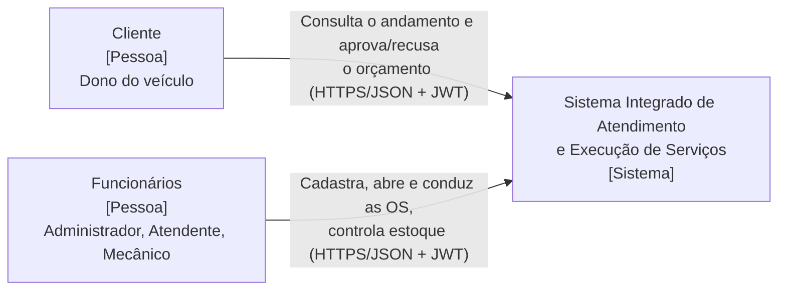
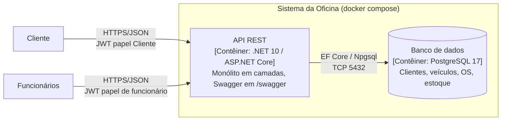
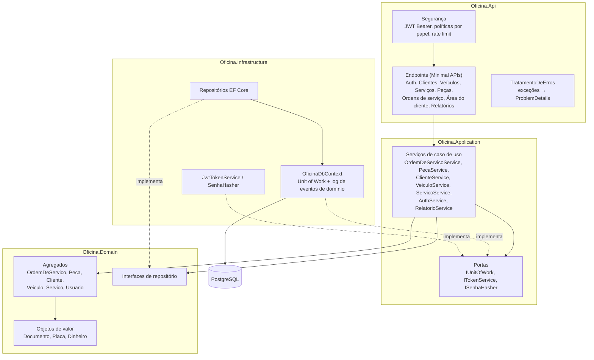

# Diagramas C4

## Nível 1 — Contexto

Não há sistemas externos no MVP: o "envio" do orçamento é a disponibilização na API do cliente.

## Nível 2 — Contêineres

## Nível 3 — Componentes da API

As setas contínuas apontam para dentro (Api → Application → Domain). A Infrastructure implementa as interfaces definidas nas camadas internas.
