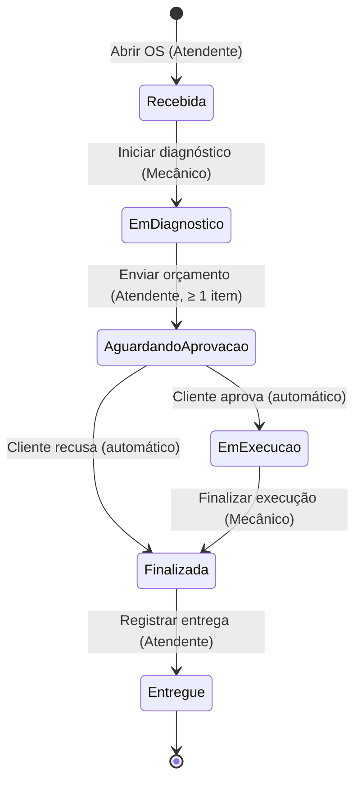

# Máquina de estados da Ordem de Serviço

Implementação: `src/Oficina.Domain/OrdensDeServico/OrdemDeServico.cs` (dicionário `Transicoes` + método `MudarStatus`).

## Matriz de transições

Qualquer transição fora da matriz → `TransicaoDeStatusInvalidaException` → **HTTP 409**.

| De \ Para | EmDiagnostico | AguardandoAprovacao | EmExecucao | Finalizada | Entregue |
|---|---|---|---|---|---|
| Recebida | Mecânico | — | — | — | — |
| EmDiagnostico | — | Atendente (≥ 1 item) | — | — | — |
| AguardandoAprovacao | — | — | Cliente aprova | Cliente recusa | — |
| EmExecucao | — | — | — | Mecânico | — |
| Finalizada | — | — | — | — | Atendente |

## Ação → endpoint → efeito

| Ação | Endpoint | Status resultante | Efeitos |
|---|---|---|---|
| Abrir OS | `POST /api/v1/ordens-servico` | Recebida | Gera `NumeroOS`, cadastra o veículo se a placa for nova |
| Iniciar diagnóstico | `POST /ordens-servico/{id}/diagnostico` | EmDiagnostico | — |
| Incluir/remover serviço/peça | `POST/DELETE /ordens-servico/{id}/servicos` e `/pecas` | (mantém) | Recalcula o orçamento, versão +1 |
| Enviar orçamento | `POST /ordens-servico/{id}/orcamento/envio` | AguardandoAprovacao | Orçamento disponível em `/me/ordens-servico` |
| Aprovar | `POST /me/ordens-servico/{id}/orcamento/aprovacao` | EmExecucao | Baixa de estoque na mesma transação; início da execução |
| Recusar | `POST /me/ordens-servico/{id}/orcamento/recusa` | Finalizada | `Resultado = OrcamentoRecusado`; estoque intocado |
| Finalizar execução | `POST /ordens-servico/{id}/execucao/finalizacao` | Finalizada | Fim da execução; `Resultado = Concluida` |
| Registrar entrega | `POST /ordens-servico/{id}/entrega` | Entregue | Data de entrega |

Toda mudança grava um `HistoricoStatus` (de, para, data/hora UTC, usuário) e emite o evento `StatusDaOSAlterado`.
