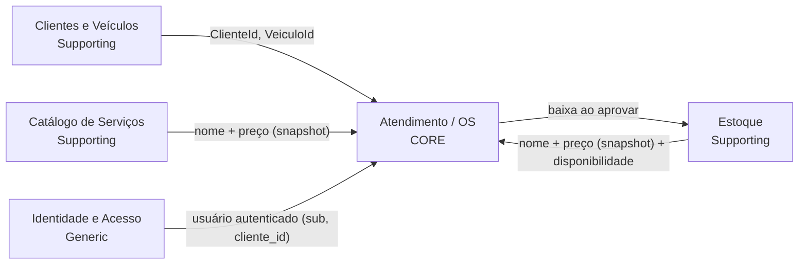

# Domínio — Linguagem ubíqua, modelo e relação com o código

> Convenção: termos de negócio em português (exatamente como no código), termos técnicos em inglês (`Repository`, `DbContext`).

## 1. Bounded contexts

| Contexto | Tipo | Responsabilidade | Pasta (em cada camada) |
|---|---|---|---|
| Atendimento (Ordens de Serviço) | Core | Ciclo de vida da OS, orçamento, aprovação, status, tempo de execução | `OrdensDeServico/` |
| Estoque | Supporting | Peças/insumos, saldo, movimentações, estoque mínimo | `Estoque/` |
| Catálogo de Serviços | Supporting | Serviços oferecidos, preço de mão de obra, tempo estimado | `Catalogo/` |
| Clientes e Veículos | Supporting | Cadastro de clientes (PF/PJ) e veículos | `Clientes/`, `Veiculos/` |
| Identidade e Acesso | Generic | Usuários, login, emissão de JWT | `Identidade/` |

A OS referencia outros agregados **por Id** e guarda **snapshot de preço**: o preço do catálogo pode mudar depois, mas o orçamento já apresentado não muda.

## 2. Agregados, entidades e objetos de valor

| Agregado (raiz) | Entidades internas | Objetos de valor | Invariantes |
|---|---|---|---|
| `OrdemDeServico` | `ItemServico`, `ItemPeca`, `HistoricoStatus`, `Orcamento` (owned) | `Dinheiro` | Transição de status só pela matriz; itens só editáveis em `Recebida`/`EmDiagnostico`; orçamento só enviado com ≥ 1 item |
| `Cliente` | — | `Documento` (CPF/CNPJ) | Documento válido e único |
| `Veiculo` | — | `Placa` | Placa válida e única; ano entre 1900 e ano atual + 1; pertence a um cliente |
| `Servico` | — | `Dinheiro` | Preço ≥ 0; tempo estimado > 0; nome único |
| `Peca` | `MovimentacaoEstoque` | `Dinheiro` | Saldo nunca negativo; toda alteração de saldo gera movimentação |
| `Usuario` | — | — | Login único; papel obrigatório; cliente tem `ClienteId` |

| Objeto de valor | Regra |
|---|---|
| `Documento` | CPF (11 dígitos) ou CNPJ (14 posições), com dígitos verificadores (módulo 11). Aceita o **CNPJ alfanumérico** (IN RFB 2.229/2024). Rejeita sequências repetidas. Guarda só os caracteres significativos |
| `Placa` | Antiga `AAA9999` ou Mercosul `AAA9A99`: `^[A-Z]{3}[0-9][A-Z0-9][0-9]{2}$` após normalizar (maiúsculas, sem hífen) |
| `Dinheiro` | `decimal`, 2 casas, nunca negativo |

## 3. Eventos de domínio

Coletados no agregado (`AggregateRoot.Eventos`) e registrados no log pelo `OficinaDbContext` depois do commit.

| Fluxo | Eventos (nome no código) |
|---|---|
| Criação da OS | `OrdemDeServicoAberta`, `DiagnosticoIniciado`, `ServicoIncluidoNaOS`, `PecaIncluidaNaOS`, `OrcamentoGerado`, `OrcamentoEnviado` |
| Acompanhamento da OS | `OrcamentoAprovado`, `OrcamentoRecusado`, `ExecucaoIniciada`, `ExecucaoFinalizada`, `VeiculoEntregue`, `StatusDaOSAlterado` |
| Gestão de peças e insumos | `PecaCadastrada`, `EntradaDeEstoqueRegistrada`, `EstoqueBaixadoPorOS`, `EstoqueAbaixoDoMinimo` |

## 4. Comandos, atores e políticas

| Comando (método) | Ator (papel) | Evento(s) |
|---|---|---|
| `AbrirAsync` / `OrdemDeServico.Abrir` | Atendente | `OrdemDeServicoAberta` |
| `IniciarDiagnostico` | Mecânico | `DiagnosticoIniciado`, `StatusDaOSAlterado` |
| `AdicionarServico` / `AdicionarPeca` | Mecânico | `ServicoIncluidoNaOS` / `PecaIncluidaNaOS`, `OrcamentoGerado` |
| `EnviarOrcamento` | Atendente | `OrcamentoEnviado`, `StatusDaOSAlterado` |
| `AprovarOrcamento` | Cliente | `OrcamentoAprovado`, `ExecucaoIniciada`, `EstoqueBaixadoPorOS` |
| `RecusarOrcamento` | Cliente | `OrcamentoRecusado`, `StatusDaOSAlterado` |
| `FinalizarExecucao` | Mecânico | `ExecucaoFinalizada`, `StatusDaOSAlterado` |
| `RegistrarEntrega` | Atendente | `VeiculoEntregue`, `StatusDaOSAlterado` |
| `Peca` (cadastro) / `RegistrarEntrada` | Administrador | `PecaCadastrada` / `EntradaDeEstoqueRegistrada` |

| Política | Implementação |
|---|---|
| Quando o orçamento é enviado → OS vai para `AguardandoAprovacao` | `OrdemDeServico.EnviarOrcamento` |
| Quando o orçamento é aprovado → baixar estoque **e** ir para `EmExecucao`, na mesma transação | `OrdemDeServicoService.AprovarOrcamentoAsync` |
| Quando o orçamento é recusado → `Finalizada` com resultado "Orçamento recusado" | `OrdemDeServico.RecusarOrcamento` |
| Quando a baixa deixa saldo ≤ mínimo → `EstoqueAbaixoDoMinimo` | `Peca.BaixarPorOS` |
| Qualquer mudança de status → registrar `HistoricoStatus` | `OrdemDeServico.MudarStatus` |
| Item alterado → recalcular orçamento (versão +1) | `OrdemDeServico.RecalcularOrcamento` |

## 5. Glossário

| Termo | Definição | Nome no código |
|---|---|---|
| Ordem de Serviço (OS) | Registro de um atendimento a um veículo, do recebimento à entrega | `OrdemDeServico` |
| Número da OS | Identificador legível e sequencial | `OrdemDeServico.Numero` (`OS-2026-000123`) |
| Status da OS | Etapa do atendimento | `StatusOS` |
| Orçamento | Total de serviços + peças apresentado ao cliente; tem versão | `Orcamento` |
| Situação do orçamento | Rascunho, Enviado, Aprovado ou Recusado | `SituacaoOrcamento` |
| Item de serviço | Serviço do catálogo incluído na OS, com preço congelado | `ItemServico` |
| Item de peça | Peça/insumo incluído na OS, com quantidade e preço congelado | `ItemPeca` |
| Peça | Item de estoque contado em unidades | `TipoItem.Peca` |
| Insumo | Material consumível (óleo, fluido) controlado em estoque | `TipoItem.Insumo` |
| Saldo | Quantidade disponível de uma peça/insumo | `Peca.Saldo` |
| Estoque mínimo | Saldo a partir do qual a oficina deve repor | `Peca.EstoqueMinimo` |
| Entrada de estoque | Aumento de saldo (compra/reposição) | `MovimentacaoEstoque(Tipo=Entrada)` |
| Baixa de estoque | Saída de quantidade causada por uma OS aprovada | `MovimentacaoEstoque(Tipo=SaidaOS)` |
| Diagnóstico | Etapa em que o mecânico avalia o veículo e monta o orçamento | `StatusOS.EmDiagnostico` |
| Execução | Etapa em que o serviço aprovado é realizado | `StatusOS.EmExecucao` |
| Tempo de execução | Intervalo entre entrar em `EmExecucao` e entrar em `Finalizada` | `OrdemDeServico.TempoDeExecucao` |
| Resultado da OS | Concluída ou Orçamento recusado | `ResultadoOS` |
| Documento | CPF ou CNPJ do cliente | `Documento` |
| Cliente | Pessoa física ou jurídica dona do veículo | `Cliente` |
| Atendente / Mecânico / Administrador | Papéis dos funcionários | `Papel` |

## 6. Matriz documentação ↔ código

| Elemento do modelo | Arquivo |
|---|---|
| Agregado Ordem de Serviço + máquina de estados | `src/Oficina.Domain/OrdensDeServico/OrdemDeServico.cs` |
| Orçamento | `src/Oficina.Domain/OrdensDeServico/Orcamento.cs` |
| Itens de serviço/peça e histórico de status | `src/Oficina.Domain/OrdensDeServico/Itens.cs` |
| Status e resultado da OS | `src/Oficina.Domain/OrdensDeServico/StatusOS.cs` |
| Eventos da OS | `src/Oficina.Domain/OrdensDeServico/Eventos.cs` |
| Agregado Peça + movimentações | `src/Oficina.Domain/Estoque/Peca.cs`, `MovimentacaoEstoque.cs` |
| Eventos de estoque | `src/Oficina.Domain/Estoque/Eventos.cs` |
| Cliente e Documento (CPF/CNPJ) | `src/Oficina.Domain/Clientes/Cliente.cs`, `Documento.cs` |
| Veículo e Placa | `src/Oficina.Domain/Veiculos/Veiculo.cs`, `Placa.cs` |
| Serviço do catálogo | `src/Oficina.Domain/Catalogo/Servico.cs` |
| Usuário e papéis | `src/Oficina.Domain/Identidade/Usuario.cs` |
| Dinheiro | `src/Oficina.Domain/Comum/Dinheiro.cs` |
| Casos de uso da OS (abrir → entregar, aprovação transacional) | `src/Oficina.Application/OrdensDeServico/OrdemDeServicoService.cs` |
| Tempo médio de execução | `src/Oficina.Application/Relatorios/RelatorioService.cs` |
| Login e emissão de JWT | `src/Oficina.Application/Identidade/AuthService.cs`, `src/Oficina.Infrastructure/Seguranca/JwtTokenService.cs` |
| Unit of Work + despacho de eventos | `src/Oficina.Infrastructure/Persistencia/OficinaDbContext.cs` |
| Concorrência otimista (xmin) | `src/Oficina.Infrastructure/Persistencia/Configuracoes/PecaConfiguracao.cs` |
| Endpoints da OS e da área do cliente | `src/Oficina.Api/Endpoints/OrdemDeServicoEndpoints.cs`, `AcessoEndpoints.cs` |
